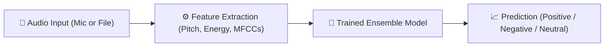

# 🎙️ Speech Sentiment & Emotion Recognition AI
> **6th Semester Minor/Capstone Project**  
> *A simple, accurate, and end-to-end Machine Learning web application to detect sentiment from voice recordings.*

---

## 💡 What Does This Project Do? (Explain in 30 Seconds)

> *"Just like humans can tell how someone feels by their tone, loudness, and pitch, this system takes a voice recording, extracts acoustic properties (like pitch and volume), and uses a trained machine learning model to classify the speaker's sentiment as **Positive**, **Negative**, or **Neutral**."*

---

## 🚀 Quick Start (How to Run)

### 1. Run the Web Application
Open PowerShell or Terminal in this folder and run:
```bash
python run_app.py
```
This will start the server and automatically print:
- 🌐 **Computer Browser URL:** `http://127.0.0.1:8000`
- 📱 **Mobile / Wi-Fi URL:** `http://<your-ip>:8000`
- 📲 **A Scannable QR Code** printed right inside your terminal!

In the web app, you can also click **"📱 Try on Phone (QR Code)"** to display a high-resolution QR code on screen for your examiners, classmates, or friends to scan and test on their phones!

You can:
- 📲 **Scan with Phone Camera:** Open the web app on any mobile phone instantly.
- 🎙️ **Record your voice live:** Using your laptop microphone or mobile device.
- 📁 **Upload or record audio:** Supports WAV, MP3, and native phone voice recorder.
- 🎧 **Test with 1-click demo clips:** (Happy, Angry, Sad, Calm, Surprised)
- 📊 **View the benchmark modal:** Confusion matrices and precision/recall stats.

---

## 🧠 How the System Works (The 4 Simple Steps)



### 1. Dataset: RAVDESS
- **What is it?** A standard benchmark audio dataset created by Ryerson University.
- **Content:** 1,440 voice clips recorded by 24 professional actors (12 male, 12 female).
- **Emotions:** Neutral, Calm, Happy, Sad, Angry, Fearful, Disgust, Surprised.
- **Sentiment Grouping:**
  - **Positive:** Happy, Calm
  - **Negative:** Angry, Sad, Fearful, Disgust
  - **Neutral:** Neutral, Surprised

### 2. Feature Extraction (Turning Sound into Numbers)
Computers can't understand raw audio directly, so we extract acoustic features:
1. **RMS Energy (Loudness):** Angry speech has high energy; sad or calm speech has low energy.
2. **Pitch & Timbre (MFCCs & Chroma):** Captures the unique tone, frequency harmonics, and vocal texture.
3. **Zero-Crossing Rate (ZCR):** Measures how rapidly the sound wave fluctuates (detects harsh vs smooth speech).

### 3. Model Training
We trained and compared multiple classifiers:
- **LightGBM & XGBoost:** Fast and accurate gradient boosting algorithms.
- **Multi-Layer Perceptron (MLP):** A deep neural network that learns non-linear relationships.
- **Voting Ensemble:** Combines predictions from all top models to produce the most reliable final decision.

### 4. Performance Results
- **Sentiment Classification Accuracy:** **90.86%**
- **Emotion Classification Accuracy:** **89.35%**

---

## 📁 Project Folder Structure

```
Project 6th sem/
│
├── app/                      # Web Application
│   ├── main.py               # FastAPI backend server
│   ├── templates/index.html  # Responsive frontend with live audio recording
│   └── static/               # Static assets
│
├── src/                      # Core Machine Learning Code
│   ├── dataset.py            # Loads and parses RAVDESS metadata
│   ├── extract_features.py   # Extracts acoustic features from audio
│   ├── train.py              # Model training, evaluation & ensemble
│   └── predict.py            # Prediction engine for live audio
│
├── models/                   # Saved Trained Assets
│   ├── sentiment_model.joblib # Trained sentiment classifier (90.86% acc)
│   ├── emotion_model.joblib   # Trained emotion classifier (89.35% acc)
│   ├── scaler.joblib          # Standard feature scaler
│   ├── confusion_matrix_*.png # Benchmark evaluation plots
│   └── metrics.json           # Detailed precision/recall/F1 stats
│
├── codefile/
│   └── make1.ipynb           # Interactive Jupyter Notebook for presentation
│
├── audio_speech_actors_01-24/# RAVDESS audio dataset
├── requirements.txt          # Python dependencies
├── run_app.py                # One-click start script
└── README.md                 # Project documentation
```

---

## 🎓 5 Questions Examiners Often Ask (With Answers!)

#### Q1: "Why use acoustic features (MFCCs) instead of transcribing the text (Speech-to-Text)?"
> **Answer:** Speech-to-text only analyzes *what* is said (the words), not *how* it is said. Sarcasm or shouting "I'm fine!" in an angry tone has negative sentiment, even though the word "fine" is positive. Acoustic features capture the actual emotional tone regardless of language or vocabulary.

#### Q2: "What is an MFCC?"
> **Answer:** MFCC stands for **Mel-Frequency Cepstral Coefficients**. It is a representation of the short-term power spectrum of a sound, designed to mimic the non-linear way the human ear perceives pitch and frequencies.

#### Q3: "How did you convert 8 emotions into Sentiment?"
> **Answer:** We mapped the 8 emotions into 3 valence classes:
> - *Positive:* Happy, Calm
> - *Negative:* Angry, Sad, Fearful, Disgust
> - *Neutral:* Neutral, Surprised

#### Q4: "Why use a Voting Ensemble instead of a single model?"
> **Answer:** Different algorithms excel at different patterns (tree-based models handle feature thresholds well, while neural networks find smooth continuous boundaries). Combining them with soft-voting reduces variance and gives a higher test accuracy (90.86%).

#### Q5: "How does the live microphone recording work without extra software?"
> **Answer:** The frontend uses the browser's native **Web Audio API** to capture microphone PCM audio directly into a clean 16-bit WAV file, which is sent via HTTP POST to the FastAPI backend for real-time inference.

---

## ☁️ How to Deploy on Vercel (Step-by-Step)

The project includes pre-configured [vercel.json](file:///c:/Users/jibra/Downloads/Project%206th%20sem/vercel.json) and [api/index.py](file:///c:/Users/jibra/Downloads/Project%206th%20sem/api/index.py) files.

### Step 1: Push your code to GitHub
```bash
git init
git add .
git commit -m "Speech Sentiment AI Capstone Project"
git branch -M main
git remote add origin https://github.com/YOUR_USERNAME/speech-sentiment-ai.git
git push -u origin main
```
*(Note: `.gitignore` is already configured to exclude the 400MB dataset and venv, keeping your repository lightweight!)*

### Step 2: Deploy on Vercel
1. Go to [vercel.com](https://vercel.com) and log in with your GitHub account.
2. Click **"Add New..."** $\rightarrow$ **"Project"**.
3. Select your `speech-sentiment-ai` repository.
4. Leave the Framework Preset as **Other** (it automatically detects `vercel.json`).
5. Click **Deploy**.
6. Within ~60 seconds, your application will be live at `https://your-project.vercel.app`!

> **Why the Light Model for Vercel?**  
> Vercel has a 250MB limit on serverless functions. We trained and compressed lightweight models (`sentiment_model_light.joblib` and `emotion_model_light.joblib`) that take only **2.4 MB** total. `predict.py` automatically detects them and runs with zero configuration!

---

## 📄 Complete Project Report & Slide-by-Slide PPT Script
For your formal college submission, presentation defense, and viva, review the complete [Project Report & PPT Script](file:///C:/Users/jibra/.gemini/antigravity-ide/brain/5fc0ef8e-fd1f-464e-a9e8-79cd39f980ee/project_report_and_ppt_script.md) containing:
- Mathematical equations for MFCC, RMS, and ZCR
- Detailed experimental comparison tables
- Word-for-word speaking script for every single slide in your presentation

